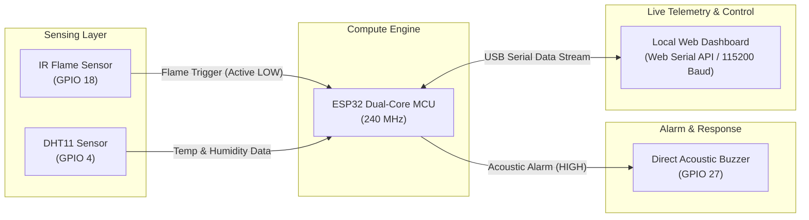

# Smart Fire Detection System: Complete ESP32 Engineering Handbook


---

## 1. Executive Overview

The **Smart Fire Detection System** is an embedded IoT-ready safety system engineered for instant fire, flame, and overheat detection. It pairs the high-performance dual-core **ESP32 microcontroller** with optical and environmental sensors to trigger instant acoustic alarms and stream live diagnostic telemetry to a local real-time web console.



---

## 2. Bill of Materials (BOM)

| Component | Quantity | Specification / Description |
| :--- | :---: | :--- |
| **ESP32 DevKit** | 1 | ESP-WROOM-32 (30-pin or 38-pin Dev Module) with micro-USB |
| **IR Flame Sensor Module** | 1 | 3-pin or 4-pin LM393-based optical flame detector (760nm–1100nm) |
| **DHT11 Sensor** | 1 | Digital single-bus ambient temperature ($0\text{--}50^\circ\text{C}$) & humidity ($20\text{--}90\%$) |
| **Piezo / Active Buzzer** | 1 | 3.3V–5V active or passive buzzer for immediate acoustic alarm |
| **Breadboard & Wires** | 1 | Standard solderless breadboard + 8 male-to-male/male-to-female jumper wires |
| **USB Cable** | 1 | Micro-USB data cable (for power, flashing, and Web Serial stream) |

---

## 3. Hardware Pinout & Connections

The hardware design is intentionally **streamlined and robust**: no relays, no external transistors, and no complex power dividers. Everything runs directly off the ESP32.

### Pinout Mapping Table

| Component | Component Pin | ESP32 Pin | Logic Level | Function |
| :--- | :--- | :--- | :--- | :--- |
| **Buzzer** | **(+) Anode (Long leg)** | **GPIO 27** | 3.3V Digital OUT | `HIGH` = Sound Alarm, `LOW` = Silent |
| **Buzzer** | **(-) Cathode (Short leg)** | **GND** | 0V Ground | Power return |
| **IR Flame Sensor** | **VCC** | **3V3** | 3.3V Power | Sensor supply voltage |
| **IR Flame Sensor** | **GND** | **GND** | 0V Ground | Ground reference |
| **IR Flame Sensor** | **OUT / DO** | **GPIO 18** | Digital IN | `LOW` = Flame detected, `HIGH` = Clear |
| **DHT11 Sensor** | **VCC** | **3V3** | 3.3V Power | Sensor supply voltage |
| **DHT11 Sensor** | **GND** | **GND** | 0V Ground | Ground reference |
| **DHT11 Sensor** | **DATA / OUT** | **GPIO 4** | Digital I/O | Temperature & humidity single-bus communication |

---

## 4. Circuit Schematic Diagram

```text
                        +--------------------------------+
                        |     ESP32 DEVKIT V1 (30-Pin)   |
                        +--------------------------------+
                        |                                |
   [IR Flame Sensor]    |                                |
   VCC ---------------->| 3V3                            |
   GND ---------------->| GND                            |
   OUT ---------------->| GPIO 18 (Digital Input)        |
                        |                                |
   [DHT11 Sensor]       |                                |
   VCC ---------------->| 3V3                            |
   GND ---------------->| GND                            |
   DATA --------------->| GPIO 4  (Single-Bus Data)      |
                        |                                |
   [Piezo Buzzer]       |                                |
   (+) Long Leg <-------| GPIO 27 (Digital Output)       |
   (-) Short Leg ------>| GND                            |
                        +--------------------------------+
                                       │
                                   [Micro-USB]
                                       │
                                       ▼
                        +--------------------------------+
                        | Local PC / Web Serial Console  |
                        | (Chrome / Edge Browser @115200)|
                        +--------------------------------+
```

---

## 5. Physical Assembly Guide

1. **Mount the ESP32**:
   * Insert the ESP32 board into the center divider of the breadboard so each row of pins is electrically isolated.
2. **Wire the Power Rails**:
   * Connect ESP32 `3V3` to the red (+) power rail of the breadboard.
   * Connect ESP32 `GND` to the blue (-) ground rail of the breadboard.
3. **Connect the Buzzer**:
   * Plug the long lead (+) of the buzzer into a row connected to **GPIO 27**.
   * Plug the short lead (-) of the buzzer into the ground rail (**GND**).
4. **Connect the IR Flame Sensor**:
   * Connect `VCC` to the 3.3V rail.
   * Connect `GND` to the ground rail.
   * Connect `OUT` (digital output) to **GPIO 18**.
5. **Connect the DHT11**:
   * Connect `VCC` to 3.3V.
   * Connect `GND` to GND.
   * Connect `DATA` to **GPIO 4**.

---

## 6. Local Web Dashboard

The project includes a **real-time local telemetry dashboard** located under the [`dashboard/`](dashboard/) folder.

### Features

* **1-Click Web Serial API**: Connects directly to the ESP32 over USB via Google Chrome or Microsoft Edge with no drivers or local server required.
* **Optical Flame Radar**: Dynamic visualizer that pulses and changes color upon flame detection.
* **Live Environmental Gauges**: Displays temperature (°C & °F) and relative humidity with color-coded safety progress tracks.
* **Real-Time Spline Chart**: 60-second rolling trend graph plotting temperature and humidity.
* **Synthesized Audio Siren**: Modulated dual-tone emergency alarm using browser Web Audio API.
* **Direct Actuator Remote Controls**: Test or silence the buzzer with a single click.
* **Live Diagnostic Terminal**: Displays incoming raw telemetry and allows exporting logs.
* **Demo Mode**: Built-in simulator to test all UI visual and audio features even when the hardware is disconnected.

### How to Launch the Dashboard

1. Open [`dashboard/index.html`](dashboard/index.html) in **Google Chrome** or **Microsoft Edge**.
2. Click **Connect ESP32 (COM)** in the top right header.
3. Select your ESP32 port (e.g. `COM7`) and click **Connect**.
4. Telemetry will begin streaming immediately!

---

## 7. Operational Verification Checklist

| Step | Action | Expected Output |
| :---: | :--- | :--- |
| **1** | Power on or press **EN / RST** on the ESP32 | Buzzer produces **2 crisp chirps ("beep-beep")** confirming power and GPIO logic |
| **2** | Open Serial Monitor at **115200 baud** | Console prints system banner, sensor status, and JSON telemetry stream |
| **3** | Wave a lighter/flame 30–50 cm in front of the IR sensor | Onboard sensor LED lights up, buzzer sounds continuously, dashboard flashes red alarm |
| **4** | Remove flame source | Buzzer silences within 1.5 seconds and returns to standby |
| **5** | Type `'1'` in Serial Monitor (or click *Force Alarm* in UI) | Buzzer turns ON immediately (Manual mode) |
| **6** | Type `'0'` in Serial Monitor (or click *Silence* in UI) | Buzzer turns OFF immediately |
| **7** | Type `'a'` in Serial Monitor (or click *Auto Mode* in UI) | Returns to automatic sensor monitoring |

---

## 8. Troubleshooting Guide

### 1. Buzzer is silent during alarm

* **Check Polarity**: Buzzers are polarized. The long leg **must** go to `GPIO 27`, and the short leg **must** go to `GND`.
* **Test via Terminal**: Open the Serial Monitor and type `1`. If it sounds, your wiring is correct and the issue is sensor trigger sensitivity.

### 2. IR Sensor stays triggered permanently or won't trigger

* **Potentiometer Calibration**: Turn the onboard blue potentiometer with a small screwdriver:
  * Turn counter-clockwise if the detection LED is always ON under room lighting.
  * Turn clockwise until the LED turns ON only when a lighter flame is introduced.

### 3. "Port is busy or doesn't exist" during upload

* **Close Active Serial Monitors**: Only one program can access `COM7` at a time. Close the VS Code Serial Monitor or click **Disconnect** on the Web Dashboard before uploading firmware.

### 4. DHT11 shows "Reading Error"

* **Power Connection**: Verify DHT11 is connected to `3V3` and `GND`. Standby cycle is 1 second; allow 2 seconds after boot for the sensor to stabilize.

---

## 9. Project File Structure

```text
Smart-Fire-Detection-IoT/
├── dashboard/
│   ├── index.html            # Web Serial Live Telemetry Dashboard
│   ├── styles.css            # Modern glassmorphism dark theme
│   └── app.js                # Web Serial streaming, chart engine & audio siren
├── src/
│   └── main.cpp              # PlatformIO C++ firmware with dual JSON/text telemetry
├── code/
│   ├── esp32_fire_suppression.ino  # Arduino IDE compatible sketch
│   └── fire_supression.ino   # Original legacy ESP8266 sketch
├── platformio.ini            # PlatformIO project configuration
├── ESP32_HANDBOOK.md         # This complete engineering reference guide
└── README.md                 # Project README with build overview
```
